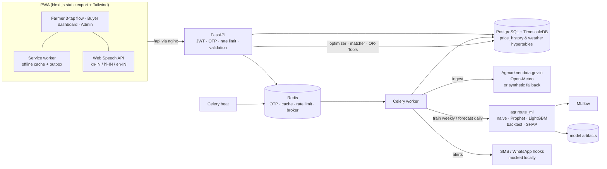

# AgriRoute 🌾

**Farm-to-market optimizer for Indian farmers.** AgriRoute tells a farmer *what* to sell, *where*, *when*, and *to which buyer* for the best **net** profit. It's also a marketplace that earns a commission on matched sales.

- **Price forecasting**: 1–30-day mandi modal-price forecasts per crop × mandi with 80% intervals. Seasonal-naive, Prophet and LightGBM compete in a rolling backtest; the winner serves. ([report](ml/reports/backtest_report.md))
- **Sell-decision optimizer**: ranks every (mandi, day) by `forecast price × qty − transport − mandi fees − spoilage − holding cost`, with temperature-aware perishability decay. An OR-Tools MIP splits large lots across mandis.
- **Marketplace**: farmers post lots, buyers post demand, and a matching engine pairs them on crop, grade, quantity, distance and price, splitting the surplus fairly. Commission is booked on confirmed deals, and buyers get an OR-Tools pickup route.
- **Alerts**: price-move and forecast-move alerts per farmer crop. In-app, plus SMS/WhatsApp hooks (mocked locally).
- **Explainability**: TreeSHAP contributions turned into plain-language reasons in ಕನ್ನಡ / हिन्दी / English, with voice output.
- **PWA**: offline-first, about 100 kB first-load JS, voice input, 3-tap farmer flow, a separate buyer dashboard and an admin view.

---

## Quick start

### Docker (one command)
```bash
docker compose up --build
```
| URL | What |
|---|---|
| http://localhost:3000 | PWA (landing → **Open app**) |
| http://localhost:8000/docs | FastAPI OpenAPI docs |
| http://localhost:5001 | MLflow (backtest runs, metrics, model artifacts) |

On first boot the one-shot `init` service runs these steps: migrations → seed (synthetic, or live if configured) → backtest + train → 30-day forecasts → matching → alerts. That takes about 2–3 minutes. `api`, `worker`, `beat` and `web` start once it succeeds. Later restarts skip the steps that are already done.

### Without Docker (SQLite + in-memory fallbacks)
```bash
make setup        # venv via uv, Python + Node deps, macOS libomp fix for LightGBM
make bootstrap    # migrate, seed, train (~75 s), forecast, match, alerts
make api          # http://localhost:8000
make web          # http://localhost:3000 (another terminal)
make test         # 45 pytest tests
```
When `REDIS_URL` is empty, the cache, OTP store and rate limiter run in memory and Celery tasks run eagerly. When `DATABASE_URL` is empty, the app uses `./agriroute.db` (SQLite).

### Demo credentials
OTP is mocked in dev: it is always **123456** and the login screen fills it in. The demo buttons on the login page skip typing.

| Role | Phone | Notes |
|---|---|---|
| Farmer | `9000000001` | Ramesh Gowda, Kolar. Kannada UI. Grows tomato, green chilli, ragi. Starts with no lots |
| Farmer | `9000000002`…`05` | Other farmers (Kannada/Hindi/English), some with open lots |
| Buyer | `9100000001` | Anil Fresh Traders, Bengaluru. Open tomato and chilli demand |
| Buyer | `9100000002`…`04` | Processor / exporter / retailer |
| Admin | `9999999999` | Users, matches, commission, model report, data quality, job triggers |

### The demo path (Definition of Done)
1. Log in as **9000000001**. Tap 🍅 → **20** → **Show best option**. You get a mandi, a day, the take-home ₹, the cost breakdown, a worst case, and reasons. Tap 🔊 to hear it.
2. **Prices** tab: 30-day forecast chart with an 80% band, 7/14/30-day change, typical error, and SHAP reasons.
3. Back on the result, tap **Find a direct buyer**. The lot form is prefilled. Tap **Post lot**. It is matched to Anil Fresh Traders immediately, and an alert plus a mock SMS/WhatsApp go out.
4. **Accept**. Then log in as **9100000001** and **Accept** too. The deal is confirmed, phone numbers are revealed, and the transaction is booked.
5. Log in as **9999999999**: GMV, commission earned (0.5% farmer + 1.5% buyer), matches, and the model leaderboard.

---

## Architecture



**Repo layout**
```
backend/   FastAPI app, services (optimizer, matcher, logistics/OR-Tools, forecasting, notify),
           ingestion (sources, data-quality, pipeline), seed + bootstrap scripts, Alembic, pytest
ml/        agriroute_ml package: features, models, backtest/train, forecast + SHAP; reports/
frontend/  Next.js 14 app router PWA (static export), Tailwind, custom SW, i18n, voice
infra/     Dockerfiles, nginx config
docs/      PITCH.md (one-page startup pitch)
.github/   CI: lint + tests on SQLite and TimescaleDB, typecheck + build, compose smoke test
```

**Scheduled jobs** (Celery beat, IST): ingest at 21:30 and 06:00 · forecasts at 06:30 · alerts at 07:00 · matching every 10 min · retrain on Sundays at 02:00. Admins can trigger any job from the admin view.

---

## Data model

| Table | Purpose / key columns | Indexes |
|---|---|---|
| `users` | phone (unique), role farmer/buyer/admin, language | phone, role |
| `farmers` / `buyers` | 1:1 profile with lat/lon, village / business, SMS & WhatsApp opt-ins | user_id unique |
| `crops` | code, names en/hi/kn, perishability `k`, storage cost, Agmarknet name | code unique |
| `msp` | (crop, season_year) → MSP; flags estimates | PK |
| `farmer_crops` | watchlist used for alerts | PK |
| `mandis` | lat/lon, market fee %, commission %, hamali ₹/qtl | code unique |
| `price_history` | **hypertable**; PK (crop, mandi, date); min/modal/max, arrivals, source, `is_imputed` | (mandi,date), (crop,date) |
| `weather` | **hypertable**; PK (mandi, date); tmax/tmin/rain/humidity, `is_forecast` | PK |
| `calendar_events` | festivals with demand impact | date |
| `forecasts` | (crop, mandi, origin, target) → yhat, lo, hi, model + version | unique point, (crop,mandi,target) |
| `lots` / `demands` | supply / demand with grade, qty, remaining, price, location, dates, status | (crop,status) |
| `matches` | lot × demand, qty, price, distance, transport/qtl, score, both-side acceptance | unique pair, status |
| `transactions` | gross, farmer/buyer commission, platform revenue, payouts | match unique, created_at |
| `alerts` | kind + params (rendered per language at read time), channels, `dedup_key` unique | user, created_at |
| `ingestion_runs` / `model_runs` | data-quality reports per run; model versions + metrics | — |

Migrations: `0001` (schema, autogenerated from the models) and `0002` (TimescaleDB hypertables plus a compression policy on Postgres; skipped when the extension is missing).

---

## How the pieces work

**Forecasting** (`ml/agriroute_ml`)
- Target: log-return `log p[t+h] − log p[t]`. One *global* direct multi-horizon LightGBM is trained over all crop × mandi series, with horizon as a feature.
- Features: price returns (1/7/14/30d), volatility, deviations from 7/30/90/365-day means, YoY, arrivals vs normal, 7/30-day rain, temperature, MSP ratio, festival proximity at origin and at target, target day-of-year, and last year's move over the same window.
- Backtest: rolling origin (4 origins × 6 horizons). All models are compared on identical cells, and the lowest mean 7/14/30-day MAPE wins.
- Intervals: 80% split-conformal intervals from backtest residuals, per horizon.
- Current results (synthetic data):

  | Model | 7-day | 14-day | 30-day | Mean |
  |---|---|---|---|---|
  | **LightGBM** ✔ | 6.20 | 8.16 | 10.44 | **8.27** |
  | Prophet | 7.68 | 8.55 | 13.53 | 9.92 |
  | Seasonal naive | 7.30 | 11.31 | 12.92 | 10.51 |

**Optimizer** (`backend/app/services/optimizer.py`, `logistics.py`)
- Road km = haversine × 1.3. The cheapest fleet (pickup / tempo / truck) is chosen by trip count, with a return-leg factor.
- Spoilage = `1 − exp(−k · Q10^((T−25)/10) · (days held + transit))`. It uses the mandi's weather. Options losing more than 35% are dropped.
- Holding cost = storage plus a 12%/yr cost of waiting for cash. The worst case uses the interval's lower bound.
- Large lots: a MIP (SCIP via OR-Tools) caps each mandi-day at 5% of typical arrivals and adds per-truck trip costs.

**Matcher** (`backend/app/services/matcher.py`)
- Hard constraints: crop, grade ≥ minimum, distance ≤ buyer max, `ask + transport/qtl ≤ bid`, and availability before the needed-by date.
- Score: 40% price surplus, 30% quantity fit, 20% proximity, 10% grade. Assignment is greedy with partial fills.
- Price = `ask + (bid − landed cost)/2`, so the surplus is split evenly. Contacts are revealed only after both sides accept.

**Ingestion** (`backend/app/ingestion`)
- Idempotent upserts on natural keys, and every run is logged with data-quality counts.
- Checks: required fields, non-positive prices, future dates, inverted min/max (repaired), modal outside the band (repaired), duplicates, and robust outliers (> 2.5× the rolling median, which catches ×10 typos).
- Gaps of 3 days or less are forward-filled and flagged `is_imputed`. Imputed rows never overwrite real data and are excluded from training targets.

---

## Decisions I made (and why)

1. **Synthetic data by default.** The data.gov.in Agmarknet feed needs an API key and only returns *today's* snapshot, so a usable training history can't come from it out of the box. The generator is seeded and deterministic, and it encodes harvest seasonality, festival ramps, AR(1) shocks, arrivals → price, rain → perishable supply shocks and an MSP floor. It also injects gaps, Sunday closures and ×10 typos so the DQ checks have work to do. Set `USE_LIVE_APIS=true` and `DATAGOV_API_KEY` to pull Agmarknet and Open-Meteo daily; on failure it falls back to synthetic.
2. **Global LightGBM on log-returns** instead of per-series models. It shares strength across 52 series, is scale-free across crops, and takes one model to serve and explain. Prophet is fit per series, so the backtest evaluates it on a sample of 24 series. All models are compared on identical cells.
3. **Conformal intervals** instead of model-native ones. Every model gets the same honest, backtest-calibrated 80% band.
4. **Static-export PWA behind nginx.** There's no Node server in production, assets are immutable, `/api` is same-origin (no CORS), and the whole UI is cacheable offline. No chart, i18n or UI libraries; the chart is about 60 lines of SVG.
5. **Language-neutral alerts.** Alerts are stored as `kind + params` and rendered in the reader's current language. SHAP features are grouped into 7 farmer-meaningful reasons (season, festival, trend, price level, arrivals, rain, MSP).
6. **Commission: 0.5% farmer + 1.5% buyer.** Buyers pay most of the fee because they save sourcing cost; the farmer fee is kept below mandi commission (3–6%). Both rates are configurable.
7. **SQLite / in-memory fallbacks** so `make bootstrap && make api` works with zero infrastructure. The same test suite runs on SQLite and Postgres/TimescaleDB in CI.
8. **Mandi fees, transport rates, MSPs and festival dates are approximate** and live in `backend/app/seed/reference_data.py`. MSP for the 2026-27 season is an estimate (+5%) and flagged `is_estimate`.
9. **Rate limits**: 300/min per IP by default and 5/min for OTP requests. Five wrong OTP attempts lock the OTP. Validation is strict: unknown fields are rejected, phone numbers must match the Indian mobile format, and coordinates must fall inside India's bounding box.

## Tests
`make test`: 45 tests covering the API (auth, OTP lockout, rate limits, validation, roles, forecasts, recommendations in Hindi, the full lot → match → accept → transaction → commission flow, rejection releasing quantity, buyer route, admin), the optimizer (net-profit identity, spoilage Q10, fleet choice, wait-vs-sell, split MIP, TSP), the matcher (each hard constraint, partial fills, greedy order, commission), and ingestion/ML (DQ checks, idempotency and imputation, generator prefix stability, feature leakage, model selection, report).

## Limitations / next steps
- Weather-forecast temperature affects spoilage; forecast rain is not yet a price-model feature.
- Real Agmarknet history backfill (via the archive CSVs) and fuzzy market-name mapping.
- A payments/escrow integration, buyer KYC, and grade verification at pickup.
- Native SMS/WhatsApp providers (Gupshup/MSG91) behind the existing webhook hook.
